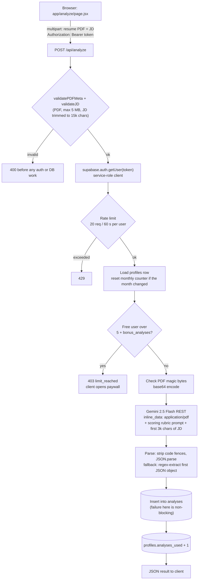
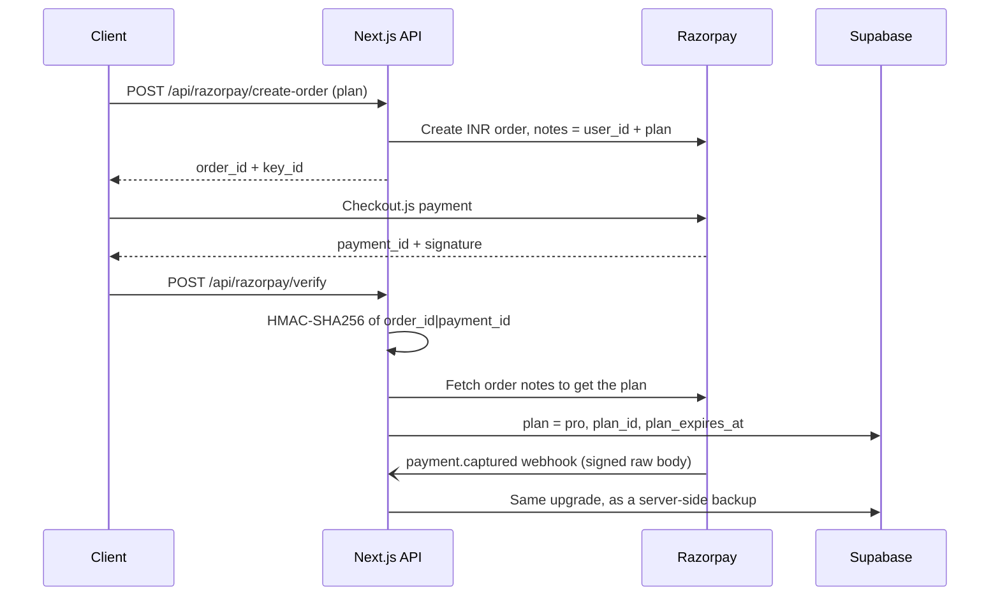

<div align="center">


# ResumeMax

**Score your resume against a real job description, see exactly which keywords you're missing, and fix weak bullets without making anything up.**

[](https://resumemax.in)


[Live site](https://resumemax.in) · [How it works](#how-it-works) · [Engineering decisions](#engineering-decisions) · [Run it locally](#getting-started)

</div>

---

## Why

Most applications are screened by an applicant tracking system before a person reads them. If the resume doesn't use the job description's language, it gets filtered out, and the candidate never learns why.

ResumeMax was built for students and early-career engineers in India going through placement season and off-campus hiring. You upload a PDF and paste a job description. It returns:

- a **0-100 match score** from a fixed rubric, not a vibe
- the **keywords you matched and the ones you're missing**
- **rewrites of weak bullets** that keep your real facts and use `[X]` where a number is unknown, instead of inventing metrics
- an **ATS structure check** of the things that actually break parsers

The same resume then powers the rest of the application: a cover letter, a cold email and LinkedIn DM, interview questions tied to your own projects, and a review of your GitHub and portfolio site for a target role.

---

## Features

**Resume analysis (free, 5 a month)**
- ATS match score, verdict (`poor` / `needs_work` / `good` / `strong`), matched and missing keywords
- 4-6 insights ranked by severity, bullet rewrites, an ATS summary and 3-5 structure checks
- **Re-analyze with before/after:** the client keeps your previous result, works out which keywords you added, and asks the model for a 1-2 sentence summary of what changed
- Works on Canva and other vector PDFs, because the PDF goes to the model as-is (no text extraction step)

**Pro tools (2 free tries each, then a pass)**

| Tool | What you get |
| --- | --- |
| Cover letter | Tailored to the JD, downloadable as an A4 PDF generated in the browser (jsPDF, loaded only on click) |
| Cold outreach | A cold email (subject + a body the prompt keeps to 120-150 words) and a LinkedIn DM the prompt limits to 280 characters |
| Interview prep | 6-8 Behavioral / Technical / Situational questions, each with a tip that points to something on your resume |
| GitHub + portfolio review | Profile, 6 most recently updated repos, README presence, languages and a scrape of your portfolio site, scored against one of 7 target roles |

**Account and history**
- Google OAuth or email magic link (Supabase Auth, PKCE code exchange)
- History of your last 20 analyses with a score-trend strip, a detail page for each, and a "Re-analyze this role" button on the history list that prefills the JD
- Referrals: share `?ref=<code>` and, when a new user signs up through it, both of you get +2 on your monthly free analysis limit

**Pricing**: one-time prepaid passes through Razorpay, no subscriptions.

| Pass | Price | Duration |
| --- | --- | --- |
| 1-Month Sprint | ₹99 | 30 days |
| Placement Season | ₹249 | 90 days |
| Off-Campus Grind | ₹499 | 180 days |

---

## How it works

The resume analysis route shows the full request flow: validate the input, verify the Supabase JWT, check the quota, call Gemini, parse defensively, then save. The Pro tool routes verify the token and check the plan before they read the upload, and spend a free try only after generation succeeds.



### The portfolio pipeline

The portfolio review mixes deterministic checks with the model, so the score doesn't rest only on what the LLM says.

```mermaid
flowchart LR
    U["GitHub username<br/>+ portfolio URL + target role"] --> P1["GitHub REST, in parallel:<br/>profile, 6 recent repos,<br/>READMEs, languages"]
    P1 --> P2["Then scrape portfolio site, if given<br/>cheerio, 8 s timeout"]
    P2 --> D["Deterministic evidence:<br/>ROLE_SKILL_MAP + ROLE_PROJECT_MAP<br/>skills, gaps, missing project types"]
    D --> G1["Gemini pass 1: analysis"]
    G1 --> Q{"Parses as JSON?"}
    Q -->|no| G2["Gemini pass 2: repair"]
    Q -->|yes| R{"Complete?"}
    G2 --> R
    R -->|"no: missing sections, fewer repo notes<br/>than repos or under 5 action items"| G3["Gemini pass 3: enrich"]
    R -->|yes| N["Normalize + fill gaps<br/>with code-generated text"]
    G3 --> N
    N --> S["Final score recomputed in code<br/>GitHub 20 / projects 40 / skills 30 / portfolio 10<br/>(portfolio counts only when a URL is given)"]
```



### Payments



---

## Engineering decisions

These are the parts of the codebase worth reading.

**The PDF goes straight to the model.** `app/api/analyze/route.js` base64-encodes the upload and sends it to Gemini as `inline_data`. Text extractors like pdf-parse return nothing for vector PDFs exported from Canva, which is a lot of student resumes. `lib/validate.js` still checks the MIME type, the 5 MB limit and the `%PDF` magic bytes before anything is sent.

**A rubric instead of an open question.** The analysis prompt sets a weighted score (keywords 40, experience depth 30, skills 20, resume quality 10), explicit score bands and verdict thresholds, rules for short keywords, and a list of things the model should *not* flag as ATS problems so it doesn't nitpick. Today's date is injected so it can tell past, current and future dates on the resume apart. Temperature is 0.3.

**Free tries that can't be overspent.** `lib/plan.js` returns `'pro'`, `'trial'` or `null` for each tool. A try is spent only after generation succeeds, through a Postgres function `use_free_pro(p_user, p_tool, p_limit)` that only increments while under the limit. If two requests race for the last try, one of them gets a 403 instead of a free result.

**Plan expiry is checked when the plan is read.** `getEffectivePlan` treats an expired `pro` row as free straight away, before anything writes to the DB, so there's no cron job. `/api/usage` downgrades the row in the background with a `.lt('plan_expires_at', now)` guard, so a renewal that lands at the same moment isn't undone.

**Don't trust the model's number.** In `app/api/portfolio/analyze/route.js`, skills and gaps are computed from GitHub data and the role maps in `lib/constants.js`, then passed to the model as evidence. The output goes through parsing, a repair pass, regex salvage, an enrich pass and normalization. The skills score is computed entirely in code, the GitHub and project scores fall back to code heuristics when the model leaves them out, and the overall score is the weighted sum computed in code, not the model's own number.

**Two payment confirmations.** The client verify call and a signature-checked `payment.captured` webhook both upgrade the plan, so a closed tab doesn't lose a payment. The plan comes from the notes the server wrote onto the Razorpay order (fetched from Razorpay in verify, read from the signed payload in the webhook), never from the client.

**Auth without middleware.** There's no `middleware.js`. Each API route reads the bearer token and verifies it with a service-role client (`auth.getUser(token)`), and history queries are also filtered by `user_id`.

**Fast landing page.** The Three.js hero (`components/three/ResumeScene.jsx`) loads with `next/dynamic` and `ssr: false`, respects `prefers-reduced-motion`, and stops rendering when it's offscreen (IntersectionObserver). jsPDF is imported only when someone clicks download.

**Security headers on every route** via `next.config.mjs`: `X-Content-Type-Options`, `X-Frame-Options: DENY`, `X-XSS-Protection`, `Referrer-Policy` and `Permissions-Policy`.

### AI calls at a glance

All AI goes through one provider: Gemini `gemini-2.5-flash`, called over REST with `fetch` (no SDK). JSON shape comes from the prompts; responses are parsed defensively.

| Route | Input | Temp | Output |
| --- | --- | --- | --- |
| `/api/analyze` | PDF + JD | 0.3 | Score, keywords, insights, rewrites, ATS checks (JSON) |
| `/api/improve-summary` | Before/after results | 0.5 | 1-2 sentence summary (max 300 tokens) |
| `/api/cover-letter` | PDF + JD | 0.7 | Plain-text letter |
| `/api/cold-outreach` | PDF + JD | 0.7 | `{ coldEmail: { subject, body }, linkedInDm }` |
| `/api/interview-prep` | PDF + JD | 0.5 | `{ questions: [{ category, question, tip }] }` |
| `/api/portfolio/analyze` | GitHub + site evidence | 0.3 / 0.1 / 0.1 | Main analysis, plus optional repair and enrich passes |

### By the numbers (counted from the code)

| | |
| --- | --- |
| HTTP route handlers | 13 (12 under `app/api` + `app/auth/callback`) |
| Pages | 7 |
| Gemini call sites / prompt templates | 8 |
| Routes that send the PDF to the model | 4 |
| Pro tools | 4, with 2 free tries each |
| Target roles for portfolio review | 7, each with 10 skills and 3 project types |

---

## Tech stack

| Layer | Choice |
| --- | --- |
| Framework | Next.js 14.2 (App Router), React 18, JavaScript/JSX |
| AI | Google Gemini 2.5 Flash via REST |
| Auth + database | Supabase (Google OAuth, magic link, Postgres) via `@supabase/supabase-js` and `@supabase/ssr` |
| Payments | Razorpay Orders API, Checkout.js, signed webhooks |
| Scraping | GitHub REST API, cheerio |
| UI | Tailwind CSS 3.4, shadcn-style components on `@base-ui/react`, lucide-react, tw-animate-css |
| Motion + 3D | framer-motion, Three.js |
| Documents | jsPDF (client side) |
| Fonts | Fraunces + DM Sans via `next/font` |
| Analytics | Vercel Analytics, Vercel Speed Insights, Google Analytics 4 |
| Hosting | Vercel |

---

## Getting started

### Prerequisites

- Node.js 18.17 or newer (required by Next.js 14) and npm
- A [Supabase](https://supabase.com) project
- A [Gemini API key](https://aistudio.google.com/apikey)
- A [Razorpay](https://razorpay.com) account (test mode works) if you want to exercise payments
- Optional: a GitHub personal access token for higher API rate limits in the portfolio review

### 1. Clone and install

```bash
git clone https://github.com/ritvikjaiswal02/ResumeMax.git
cd ResumeMax
npm install
```

### 2. Configure environment variables

```bash
cp .env.example .env.local
```

| Variable | Required | Used by |
| --- | --- | --- |
| `GEMINI_API_KEY` | Yes | Every AI route |
| `NEXT_PUBLIC_SUPABASE_URL` | Yes | Browser client, server client, auth callback |
| `NEXT_PUBLIC_SUPABASE_ANON_KEY` | Yes | Browser client, auth callback |
| `SUPABASE_SERVICE_KEY` | Yes | Service-role admin client in `lib/supabase/server.js` (keep it server-side) |
| `RAZORPAY_KEY_ID` | For payments | `/api/razorpay/create-order` (also returned to Checkout) and the order lookup in `/api/razorpay/verify` |
| `RAZORPAY_KEY_SECRET` | For payments | Order creation, order lookup and signature verification |
| `RAZORPAY_WEBHOOK_SECRET` | For payments | `/api/razorpay/webhook` signature check |
| `GITHUB_TOKEN` | Optional | `lib/github.js`, raises GitHub API rate limits |

`.env.example` also lists `OPENAI_API_KEY` and `NEXT_PUBLIC_RAZORPAY_KEY_ID`. The current code doesn't read either, so you can leave them empty. If you don't have a GitHub token, delete the `GITHUB_TOKEN` line rather than keeping the placeholder: any non-empty value is sent as a bearer token, and GitHub rejects an invalid one.

### 3. Set up Supabase

There are no migration files in the repo yet, so create these by hand in the SQL editor. The columns below are the ones the code reads and writes.

- **`profiles`** (one row per user, `id` = auth user id): `email`, `plan`, `plan_id`, `plan_expires_at`, `analyses_used`, `analyses_reset_at`, `bonus_analyses`, `free_pro_uses` (JSON object keyed by tool: `cover`, `outreach`, `interview`, `portfolio`), `referral_code`, `referred_by`, `razorpay_payment_id`, `upgraded_at`
- **`analyses`**: `id`, `user_id`, `type` (`portfolio` for portfolio reviews), `resume_name`, `jd_snippet`, `jd_text`, `job_title`, `score`, `verdict`, `result` (JSON), `created_at`
- **RPC `use_free_pro(p_user, p_tool, p_limit)`**: increments `free_pro_uses[p_tool]` for that user only if it's below `p_limit`, in a single statement, and returns `true` if it incremented

Then in **Authentication**:
- enable the Google provider and email (magic link)
- add `http://localhost:3000/auth/callback` (and your production URL) to the allowed redirect URLs

### 4. Run

```bash
npm run dev      # http://localhost:3000
```

| Script | Command |
| --- | --- |
| `npm run dev` | `next dev` |
| `npm run build` | `next build` |
| `npm run start` | `next start` |
| `npm run lint` | `next lint` |

---

## Project structure

```text
app/
├── page.jsx                     Landing page (3D hero, product demos, pricing, FAQ)
├── analyze/                     Resume analysis + Pro tools
├── history/  history/[id]/      Past analyses and score trend
├── portfolio/                   GitHub + portfolio review
├── login/  pricing/
├── auth/callback/route.js       Supabase code exchange, profile + referral setup
└── api/
    ├── analyze/                 ATS analysis (PDF -> Gemini)
    ├── improve-summary/         Before/after summary
    ├── cover-letter/  cold-outreach/  interview-prep/
    ├── portfolio/analyze/       GitHub + scrape + 1-3 Gemini passes
    ├── history/  history/[id]/
    ├── usage/                   Plan, quota, free tries, referral code
    └── razorpay/                create-order, verify, webhook
components/
├── landing/                     Marketing page and its sections
├── three/ResumeScene.jsx        Three.js hero
├── analyze/ProTools.jsx         Pro tool panels
├── AnalysisResults.jsx  PortfolioResults.jsx
└── ui/                          12 shadcn-style primitives (9 built on base-ui)
lib/
├── plan.js                      Effective plan, free-try access, use_free_pro RPC
├── validate.js                  PDF/JD validation, rate limiter
├── github.js                    GitHub API + cheerio portfolio scraper
├── constants.js                 Target roles -> skills / project types
├── api.js                       Client fetch helpers
└── supabase/                    Browser client and service-role client
hooks/useAuth.js                 Session, Google + magic-link sign-in
next.config.mjs                  Security headers
```

---

## Deployment

The live site runs on Vercel. To deploy your own copy:

1. Import the repo into Vercel (it detects Next.js, no config needed) and add the environment variables from the table above.
2. Add `https://<your-domain>/auth/callback` to Supabase's redirect URLs and set the Site URL.
3. In the Razorpay dashboard, add a webhook pointing to `https://<your-domain>/api/razorpay/webhook` for the `payment.captured` event, using the same secret as `RAZORPAY_WEBHOOK_SECRET`.
4. Switch the Razorpay keys from test to live when you're ready to take real payments.

The rate limiter in `lib/validate.js` lives in process memory, so on serverless it limits each instance separately. Put it behind a shared store if you need a hard global limit.

---

## Roadmap

Planned or in progress. None of this is on the live site yet.

- **Career profile + one-click tailored resume**: save your experience once and generate a resume tailored to each JD. Design and plan are in `docs/superpowers/`; work is underway on a feature branch.
- **Browser extension**: read the job description straight from the job board page instead of copy-pasting.
- **Automated tests**: unit tests for validation, plan logic and response parsing, with CI on pull requests.
- **Payment hardening**: constant-time signature comparison, checking that the order's `user_id` matches the caller in verify, and idempotent webhook handling.
- **Atomic counters**: move the usage increment and referral bonus into Postgres functions, as already done for free tries.
- **Shared rate limiting** across serverless instances, applied to every AI route.
- **Structured output**: use Gemini's response schema mode instead of prompt-only JSON.
- **Checked-in schema**: SQL migrations for `profiles`, `analyses` and `use_free_pro`.
- **Cleanup**: remove the unused `openai` dependency and the stale entries in `.env.example`.

---

## Author

**Ritvik Jaiswal**

- GitHub: [@ritvikjaiswal02](https://github.com/ritvikjaiswal02)
- Live project: [resumemax.in](https://resumemax.in)

Found a bug or have an idea? [Open an issue](https://github.com/ritvikjaiswal02/ResumeMax/issues). If ResumeMax helped you, a star helps other people find it.
